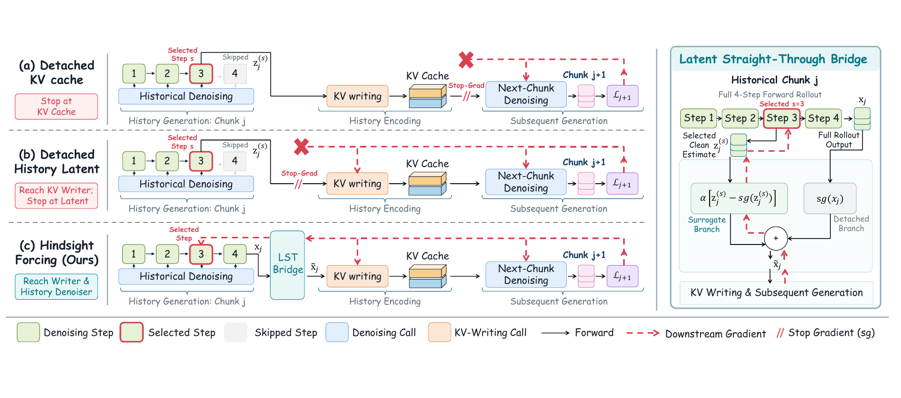

<div align="center">

# Hindsight Forcing
### Learning Better History from the Future in Autoregressive Video Diffusion

**Teach past generation with feedback from future chunks.**

[](https://github.com/haonanAN309/Hindsight-Forcing)
[](https://huggingface.co/NathanAN123/Hindsight_Forcing)
[](https://arxiv.org/abs/2611.27074)
[](https://haonanAN309.github.io/Hindsight-Forcing/)

[Quick Start](#quick-start) · [Train](#training) · [Generate](#inference) · [Model Catalog](checkpoints/README.md) · [Method Details](docs/METHODS.md)

</div>

<p align="center">
  
</p>

Each generated chunk is both the current output and history for future generation. **Hindsight Forcing lets future losses train the denoiser that produced that history**, with no extra student parameters, architecture changes, or separate trajectory replay.

The student completes a four-step rollout to produce $x_j$ and retains the graph of one selected clean estimate $z_j^{(s)}$. History is written through

$$
\widetilde{x}_j = \mathrm{sg}(x_j) + \alpha\left[z_j^{(s)}-\mathrm{sg}(z_j^{(s)})\right].
$$

The forward pass uses the final rollout output; the backward pass reaches both the history writer and selected historical denoiser.

**Included:** Training and inference for HF and four baselines; inference support for HF Long and three official-checkpoint baselines.

## Contents

- [Quick start](#quick-start)
- [Environment and model assets](#environment-and-model-assets)
- [Checkpoints](#checkpoints)
- [Training](#training)
- [Inference](#inference)
- [Method configurations](docs/METHODS.md)
- [Dependencies and reward-model setup](docs/DEPENDENCIES.md)
- [Validation](docs/VALIDATION.md)
- [Licenses and acknowledgments](#licenses-and-acknowledgments)

| Method | Training entry | Inference | Evaluation weights |
|---|---|---|---|
| Hindsight Forcing | `hf` | `hf` | Our EMA checkpoint |
| Hindsight Forcing Long | Inference only | `hf_long` | Our EMA checkpoint |
| Reward Forcing | `reward_forcing` | `reward_forcing` | Our EMA checkpoint |
| RAVEN, without CM-GRPO | `raven` | `raven` | Our EMA checkpoint |
| SGF | `sgf` | `sgf` | Our EMA checkpoint |
| SGF+ | `sgf_plus` | `sgf_plus` | Our EMA checkpoint, including both experts |
| CausVid | Official checkpoint used | `causvid` | Official four-step CFG-2 checkpoint |
| Self Forcing | Official checkpoint used | `self_forcing` | Official DMD checkpoint |
| Causal Forcing | Official checkpoint used | `causal_forcing` | Official chunkwise checkpoint |

The baseline adapters retain their method-specific designs: RAVEN's interleaved computation, Reward Forcing's Re-DMD and EMA-Sink, SGF's history reconstruction, and SGF+'s separate generation and memory parameters. The engines are kept separate to preserve their model and cache implementations.

## Quick start

### 1. Install

The reference stack is **Python 3.11, PyTorch 2.6.0 + CUDA 12.4, and FlashAttention 2.7.4.post1**. Use a CUDA-capable Linux environment; the commands below install the shared training/inference dependencies.

```bash
git clone https://github.com/haonanAN309/Hindsight-Forcing.git
cd Hindsight-Forcing
python3.11 -m venv .venv
source .venv/bin/activate
python -m pip install --upgrade pip setuptools wheel
python -m pip install torch==2.6.0 torchvision==0.21.0 \
  --index-url https://download.pytorch.org/whl/cu124
python -m pip install -r requirements.txt
python -m pip install flash-attn==2.7.4.post1 --no-build-isolation
python scripts/check_environment.py --imports --cuda
```

FlashAttention needs a matching CUDA/PyTorch build; a CUDA toolkit and compiler are needed if no compatible wheel is available. See the [minimal environment checklist](docs/DEPENDENCIES.md#minimal-environment-checklist) for package roles and asset requirements.

### 2. Download the foundation assets and HF checkpoint

```bash
hf download Wan-AI/Wan2.1-T2V-1.3B --local-dir wan_models/Wan2.1-T2V-1.3B
hf download NathanAN123/Hindsight_Forcing hf.pt --local-dir checkpoints
```

If the weight repository requires authentication, run `hf auth login` with an account that has access. The complete Wan directory supplies the text encoder, tokenizer, VAE, and model configuration. Inference does not load the training teacher or critic.

### 3. Generate a video

```bash
CUDA_VISIBLE_DEVICES=0 python inference.py \
  --method hf \
  --prompt "A giraffe walks across a sunlit savanna, its neck gently swaying." \
  --seed 42 --suite short --output-dir outputs/hf_short
```

The output is an **81-frame, 832×480 video at 16 FPS**, generated with four denoising steps per chunk. For a one-minute video, download `hf_long.pt` and switch to `--method hf_long --suite long`:

```bash
hf download NathanAN123/Hindsight_Forcing hf_long.pt --local-dir checkpoints
CUDA_VISIBLE_DEVICES=0 python inference.py \
  --method hf_long \
  --prompt "A giraffe walks across a sunlit savanna, its neck gently swaying." \
  --seed 42 --suite long --output-dir outputs/hf_long
```

## Environment and model assets

| Component | Reference configuration | Needed for |
|---|---|---|
| Python / PyTorch / torchvision | 3.11 / 2.6.0 / 0.21.0 | All methods |
| CUDA / FlashAttention | CUDA 12.4 build / 2.7.4.post1 | GPU computation |
| diffusers / transformers | 0.31.0 / 4.49.0 | Wan model and scheduler components |
| NumPy / PyAV | 1.24.4 / 13.1.0 | Arrays and video output |
| Hugging Face Hub | 0.36.2 | Model downloads |
| PEFT | 0.14.0 | Reward Forcing training |

[`requirements.txt`](requirements.txt) provides the shared dependencies. [DEPENDENCIES.md](docs/DEPENDENCIES.md) describes the complete minimum asset layout and Reward Forcing setup. The model files, prompt datasets, and generated outputs stay outside Git.

```text
wan_models/
  Wan2.1-T2V-1.3B/             # Foundation assets for all methods
  Wan2.1-T2V-14B/              # Frozen teacher; training only
checkpoints/
  initialization/causal_ode.pt # Common CF S2 initialization; training only
  hf.pt                       # Selected evaluation checkpoint
  hf_long.pt
prompts/
  vidprom_filtered_extended.txt
```

For training, also download the frozen teacher and common S2 initialization:

```bash
hf download Wan-AI/Wan2.1-T2V-14B --local-dir wan_models/Wan2.1-T2V-14B
hf download zhuhz22/Causal-Forcing chunkwise/causal_ode.pt --local-dir checkpoints/upstream_cf
mkdir -p checkpoints/initialization
mv checkpoints/upstream_cf/chunkwise/causal_ode.pt checkpoints/initialization/causal_ode.pt
```

S3 training uses the filtered and extended VidProM prompts described in the [Causal Forcing data preparation instructions](https://github.com/thu-ml/Causal-Forcing). Supply one generation prompt per line at `prompts/vidprom_filtered_extended.txt`. The student generates training videos online from these prompts.

## Checkpoints

[The checkpoint catalog](checkpoints/README.md) maps each method to its expected filename, state-dictionary key, training budget, and weight source. The machine-readable version is [model_index.json](checkpoints/model_index.json).

The six retrained EMA checkpoints are hosted in [NathanAN123/Hindsight_Forcing](https://huggingface.co/NathanAN123/Hindsight_Forcing), using flat filenames such as `hf.pt` and `sgf_plus.pt`. Access requires repository permission while it remains private. Official baseline links are included in the catalog. Place weights under `checkpoints/` or pass `--checkpoint` at inference.

The evaluated weights for retrained methods are EMA checkpoints after **150 generator updates**. Ordinary weights are cataloged separately and are not part of the hosted download. SGF+ stores both experts in the same checkpoint. Loading selects the recorded state-dictionary key and normalizes FSDP wrapper prefixes before a strict architecture check.

## Training

The default HF configuration is in [engines/hf/configs/hf.yaml](engines/hf/configs/hf.yaml). It uses:

- Wan2.1-T2V-1.3B student and critic; frozen Wan2.1-T2V-14B teacher.
- Seven chunks of three latent frames; four denoising steps per chunk.
- A selected step shared across chunks and ranks, full-rollout history, and bridge scale $\alpha=1$.
- DMD generator supervision and a separate flow-denoising critic objective.
- Global batch size 64, BF16, FSDP, and activation checkpointing.
- 150 generator updates, with five critic updates per generator update.
- Ordinary and EMA student weights; the main result uses the EMA checkpoint at global step 750.

Check the configuration without creating models or initializing CUDA:

```bash
python train.py --method hf --dry-run
```

Launch with `torchrun` for the resources available in your environment:

```bash
torchrun --standalone --nproc_per_node=gpu train.py \
  --method hf \
  --data-path prompts/vidprom_filtered_extended.txt \
  --init-checkpoint checkpoints/initialization/causal_ode.pt \
  --micro-batch 1 \
  --output-dir outputs/hf
```

For a distributed launch across hosts, use your own `torchrun` rendezvous configuration with the same training command. The launcher computes gradient accumulation from the current world size and micro-batch while retaining global batch 64. A nondivisible setting is rejected. `--accumulation-steps` can be supplied explicitly and is checked against the same batch constraint.

Change `--method` to `raven`, `reward_forcing`, `sgf`, or `sgf_plus` to select another training configuration. RAVEN uses its own update ratio, reaching 150 generator updates at global step 300; the others reach that budget at global step 750. [Method configurations](docs/METHODS.md) describe the settings that remain specific to each baseline. Reward Forcing additionally requires the reward-model assets described in [DEPENDENCIES.md](docs/DEPENDENCIES.md).

TensorBoard events and checkpoints are written under the output directory. To view HF training curves:

```bash
tensorboard --logdir outputs/hf/tensorboard
```

HF exports `model.pt` and `model_ema.pt` in `checkpoint_model_<step>/`. These exports contain student weights; complete optimizer-state recovery requires a separate training-state checkpoint.

<details>
<summary><b>Training interface reference</b></summary>

| Argument | Purpose |
|---|---|
| `--method` | `hf`, `raven`, `reward_forcing`, `sgf`, or `sgf_plus` |
| `--data-path` | One training prompt per line |
| `--init-checkpoint` | Common CF S2 student initialization |
| `--output-dir` | Logs and checkpoints |
| `--micro-batch` | Samples per rank; the launcher derives accumulation |
| `--accumulation-steps` | Optional explicit accumulation, checked against global batch 64 |
| `--seed` | Override the configuration's training seed |
| `--reward-model-path` | VideoReward directory for Reward Forcing |
| `--reward-base-model-path` | Qwen2-VL configuration/tokenizer directory |
| `--smoke-test` | One real student update plus associated critic updates; separate output directory |
| `--dry-run` | Print the resolved plan without allocating model memory |

</details>

### Run a short training check

Before a full run, exercise one actual student update and its associated critic updates:

```bash
torchrun --standalone --nproc_per_node=gpu train.py \
  --method hf --smoke-test \
  --data-path prompts/vidprom_filtered_extended.txt \
  --output-dir outputs/hf_check
```

`--smoke-test` retains the real models, seven-chunk sequences, global batch 64, rollout, losses, and method-specific update ratio. It stops after one student update, starts EMA immediately, and saves both ordinary and EMA weights in the separate `outputs/hf_check_smoke/` directory. Existing nonempty smoke directories are not overwritten. The regular training budget is unchanged when this flag is omitted. To inspect this check first, add `--dry-run`.

## Inference

Each inference process uses one visible CUDA device. Assign the device using `CUDA_VISIBLE_DEVICES`; independent prompt sets can be distributed over separate processes.

```bash
CUDA_VISIBLE_DEVICES=0 python inference.py \
  --method hf \
  --prompt "A giraffe walks across a sunlit savanna, its neck gently swaying." \
  --seed 42 \
  --suite short \
  --output-dir outputs/hf_short
```

Generate several prompts, or validate a plan without loading a model:

```bash
python inference.py --method hf --prompt-file examples/prompts.txt --dry-run

CUDA_VISIBLE_DEVICES=0 python inference.py \
  --method sgf_plus --prompt-file examples/prompts.txt \
  --suite long --output-dir outputs/sgf_plus_long
```

`short` generates 21 latent frames, decoded to 81 frames at 16 FPS. `long` generates 240 latent frames, decoded to 957 frames. Both use $832\times480$ output resolution and four denoising steps per chunk. For paired comparisons, use identical task files:

```json
[
  {"id": "example_0000", "prompt": "A person walks along a beach.", "seed": 42, "suite": "short"}
]
```

Pass this file with `--task-file`. When using a plain prompt file, sample seeds are `--seed + prompt_index`. Generated MP4s, per-sample metadata, and completion records are written under `outputs/`. Repeating a matching plan skips completed videos.

By default, inference uses the catalog's evaluation weights. Use `--weights ordinary` for a retrained method's ordinary weights, or `--checkpoint` and an explicit `--weight-key` for another compatible checkpoint.

### HF Long

HF Long is a long-horizon model trained with **per-rank independent step sampling**. It is provided for inference only, with released EMA weights and short- and long-video inference configurations. Its training code is not included.

```bash
hf download NathanAN123/Hindsight_Forcing hf_long.pt --local-dir checkpoints
CUDA_VISIBLE_DEVICES=0 python inference.py \
  --method hf_long --checkpoint checkpoints/hf_long.pt \
  --prompt "A giraffe walks across a sunlit savanna." \
  --suite long --seed 42 --output-dir outputs/hf_long
```

HF Long uses the evaluated cache=12, contiguous/span=12 policy for both short and long generation.

<details>
<summary><b>Inference interface reference</b></summary>

| Argument | Purpose |
|---|---|
| `--method` | Any method listed in the model table above |
| `--prompt` | A single text prompt |
| `--prompt-file` | One prompt per line; seeds increment from `--seed` |
| `--task-file` | JSON/JSONL with explicit `id`, `prompt`, `seed`, and `suite` |
| `--suite` | `short` (81 frames) or `long` (957 frames) |
| `--seed` | Base generation seed; default 42 |
| `--output-dir` | Video, metadata, and completion-record directory |
| `--checkpoint` | Override the catalog's checkpoint path |
| `--weight-key` | Explicit `generator` or `generator_ema` key |
| `--weights ordinary` | Select a locally supplied ordinary checkpoint from the catalog |
| `--dry-run` | Validate and display the inference plan without loading models |

Use exactly one of `--prompt`, `--prompt-file`, and `--task-file`. A task file must contain only the suite selected by `--suite`. Run different engines in separate Python processes.

</details>

### Cache policies

Short inference preserves each method's evaluated native configuration; HF uses its original 21-latent-frame cache. The provided long-inference policies are:

| Method | Budget (Latent frames) | Long-horizon inference strategy |
|---|---:|---|
| CausVid | 21 | Native overlap extension (3-latent-frame overlap) |
| Self Forcing | 21 | Sink + FIFO (RoPE span 21) |
| Causal Forcing | 21 | Sink + FIFO (RoPE span 21) |
| Reward Forcing | 9 | Native EMA-Sink (decay = 0.999) |
| RAVEN | 21 | Sink + FIFO (RoPE span 21) |
| SGF | 12 | Sink + FIFO (RoPE span 21) |
| SGF+ | 12 | Sink + FIFO (RoPE span 12) |
| Hindsight Forcing (Ours) | 12 | Sink + FIFO (RoPE span 21) |
| Hindsight Forcing Long (Ours) | 12 | Sink + FIFO (RoPE span 12) |

Sink + FIFO budgets include the current chunk and a three-latent-frame sink. SF, CF, and RAVEN use the SGF-derived rolling-cache backend for long inference. These are the explicit comparison configurations, not a claim that every upstream project's default is identical. The `hf` entry uses `hf.pt`; the `hf_long` entry uses `hf_long.pt`. With a 12-frame budget, the packed cache holds the initial chunk, the two most recent historical chunks, and the current chunk.

## Repository layout

```text
train.py                    Portable training entry
inference.py                Portable inference entry
configs/inference.json      Evaluated adapter and cache settings
engines/hf/                 HF training implementation
engines/raven/              RAVEN distillation adapter
engines/reward/             Reward Forcing adapter
engines/sgf/                SGF implementation
engines/sgf_plus/           SGF+ implementation
engines/causvid/            Official CausVid inference dependency
release_runtime/            Entry-point and inference utilities
checkpoints/                Weight catalog; no bundled tensors
docs/                      Method, dependency, and validation notes
tests/                     CPU release checks
licenses/                  Upstream licenses
```

## Validation

Run the release checks with:

```bash
PYTHONDONTWRITEBYTECODE=1 python -m unittest discover -s tests -v
```

The tests cover the retained history-gradient path and portable interfaces. See [VALIDATION.md](docs/VALIDATION.md) for GPU inference results and the per-method training execution checks.

## Paper and project page

- **Paper:** [arXiv:2611.27074](https://arxiv.org/abs/2611.27074).
- **Project page:** [Hindsight Forcing](https://haonanAN309.github.io/Hindsight-Forcing/).
- **Code:** [haonanAN309/Hindsight-Forcing](https://github.com/haonanAN309/Hindsight-Forcing).
- **Weights:** [NathanAN123/Hindsight_Forcing](https://huggingface.co/NathanAN123/Hindsight_Forcing).

If you find this work useful, please cite:

```bibtex
@article{an2026hindsightforcing,
  title={Hindsight Forcing: Learning Better History from the Future in Autoregressive Video Diffusion},
  author={An, Haonan and Tao, Yihang and Guo, Yu and Chen, Renlong and Zhang, Jiasheng and Fang, Yuguang},
  journal={arXiv preprint arXiv:2611.27074},
  year={2026},
  url={https://arxiv.org/abs/2611.27074}
}
```

## Licenses and acknowledgments

This work builds on Causal Forcing, Wan, RAVEN, Reward Forcing, Self Gradient Forcing, Self Gradient Forcing Plus, and CausVid. Their source attributions and licenses are retained in [THIRD_PARTY_NOTICES.md](THIRD_PARTY_NOTICES.md).

The HF/CF-derived implementation is Apache-2.0. **RAVEN-derived components are CC BY-NC 4.0, and CausVid-derived components are CC BY-NC-SA 4.0.** The bundle therefore contains components with different terms; the root license does not override their restrictions. Pretrained models, reward models, and datasets remain subject to their respective upstream terms.
